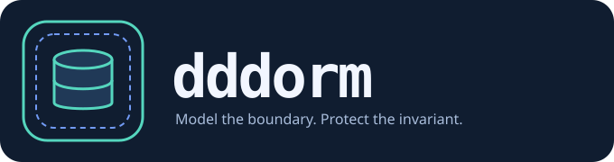
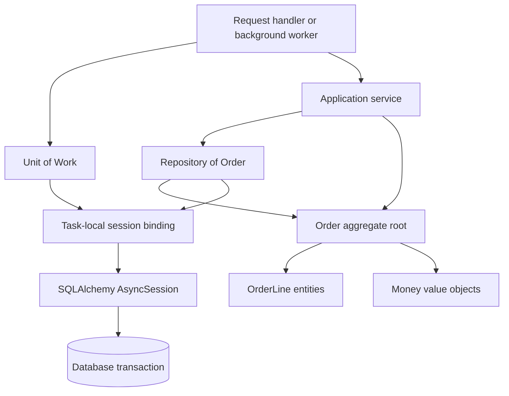

<p align="center"></p>

# dddorm

> Disclaimer: Proof of Concept — inspection only
>
> Do not run, install, build, deploy, or otherwise execute anything from this repository. This includes the CLI, example applications, bootstrap scripts, container configurations, editor tasks and automation workflows. The repository is provided for reading and architectural discussion only.
>
> Much of this project was built with AI-Assisted Development workflows for demonstrating and testing logic. That describes its exploratory purpose; it does not establish that the code or its logic has been tested, independently reviewed, or verified. Treat all code, configuration, documentation and outputs as untrusted illustrative material. Do not rely on them for correctness, security, reliability or deployment decisions, even if a check reports success.
>
> This project has a shallow Git history because it is based on proprietary codebases that could not be cloned into this public repository. The GitHub version is provided for illustrative purposes only and does not include the original codebases or their development histories. Here, “shallow history” describes the limited public development record, not a Git shallow-clone configuration.
>
> It is not actively maintained and is not intended for production use. Features, configuration formats, APIs and command-line interfaces may change without notice. No guarantees are provided regarding stability, security, compatibility or ongoing support.

## Architectural patterns: Unit of Work and Domain-Driven Design

`dddorm` is a small, educational Python library implementing **Unit of Work**
and tactical **Domain-Driven Design (DDD)** patterns with SQLAlchemy 2.x,
Pydantic v2, and asynchronous Python.

### Unit of Work

Martin Fowler describes the [Unit of Work pattern](https://martinfowler.com/eaaCatalog/unitOfWork.html)
in *[Patterns of Enterprise Application Architecture](https://martinfowler.com/books/eaa.html)*.
It tracks changes made during a business transaction and coordinates the database
writes needed to persist them, including handling concurrency concerns.

Here, SQLAlchemy's session provides change tracking and flush behaviour. The
`UnitOfWork` abstraction adds an explicit application scope for session ownership,
commit, rollback, and cleanup. Repositories participate in that scope so an
application service can persist related changes together. A task-checked
`ContextVar` makes the session available without passing it through every layer;
the transaction remains the mechanism that makes database changes atomic.

### Domain-Driven Design

Eric Evans presents DDD in *Domain-Driven Design: Tackling Complexity in the Heart
of Software*. His [DDD Reference](https://www.domainlanguage.com/ddd/reference/)
summarises the book's patterns. DDD connects the software model to the business
domain through a shared language and explicit modelling decisions. This project
focuses on entities, value objects, aggregates, and repositories.

For data applications, the central benefit explored here is that DDD forces us
to reason about **consistency boundaries**: which entities must change together
atomically to preserve domain invariants. Aggregates define those boundaries,
their roots enforce the rules, repositories manage their persistence, and Units
of Work coordinate transactional consistency. This makes business rules and
their concurrency requirements explicit in the design.

In the Orders example, an order's status and its lines belong to one aggregate
because finalisation must prevent further line changes. The ORM maps those
objects to rows; choosing that boundary remains a domain design decision.

## Why consistency boundaries come first

An order may only be changed while it is a draft. A line's quantity and its
order's status live in different rows, but the business rule spans both. They
must be considered together when deciding whether a command is valid.

DDD asks which objects must change atomically to preserve an invariant. An
**aggregate** defines that boundary. Its root accepts commands, validates them,
and coordinates changes to owned entities and values. A repository retrieves
the aggregate, and a Unit of Work coordinates persistence in a transaction.

An ORM supplies mapping, identity tracking, and database writes. It cannot choose
the right business boundary for us. This repository makes that design decision
visible without introducing a framework around every SQLAlchemy operation.

## The five building blocks

| Concept | Domain responsibility | Implementation here |
| --- | --- | --- |
| Entity | Identity survives changes in attributes | Abstract declarative base with a UUID primary key; equality uses concrete type and ID |
| Aggregate root | Entry point for a consistency boundary | Entity plus a SQLAlchemy version column and protected mutation hook |
| Value object | Validated data identified by its values | Frozen Pydantic model; nested values must themselves be immutable |
| Repository | Load and add aggregate roots | Typed abstract `Repository[T]`, optional injected session, default async `get_by_id()` |
| Unit of Work | Coordinate a transaction around application work | Async scope owning a session, task-checked `ContextVar`, explicit commit/flush/rollback |



## Read the example

The following snippets are illustrative material, not execution instructions.
Python 3.11+, SQLAlchemy 2.x, and Pydantic v2 describe the intended environment.
An async database driver is a separate choice; the optional `examples` metadata
declares `aiosqlite`, without installing it. No database is created automatically.

An aggregate accepts a command and protects its invariant:

```python
from decimal import Decimal
from examples.orders.models import Money, Order

order = Order(currency="GBP")
line = order.add_line("BOOK", 2, Money(amount=Decimal("12.50"), currency="GBP"))
order.change_quantity(line.id, 3)
order.finalise()
# order.remove_line(line.id) would raise ValueError: the order is finalised.
```

`Money` validates amounts and a three-uppercase-letter currency format (it does
not validate an ISO currency catalogue). Lines must use the order's currency;
quantities must be positive; an empty order cannot be finalised. Amounts and
totals are bounded to 18 digits with at most two decimal places. This deliberately
small model does not cover every currency's rounding rules.

Application services resolve repositories inside the transaction scope:

```python
from dddorm import UnitOfWork
from examples.orders.repositories import OrderRepository

async def finalise_order(session_factory, order_id):
    async with UnitOfWork(session_factory, on_exit="commit"):
        order = await OrderRepository().require(order_id)
        order.finalise()
```

The factory supplies a **fresh `AsyncSession` for every scope**, normally through
`async_sessionmaker(engine, expire_on_commit=False)`. The engine, driver, schema,
and connection settings belong to the calling application. Repositories resolve
the active session when used; they never commit. `add()` is synchronous because
it only registers an object; all database IO is asynchronous.

`examples/orders/application.py` includes creation, quantity updates, finalisation,
and a conflict illustration with two independently loaded copies. That last
function exposes session operations to explain the mechanism; normal services
use the Unit of Work.

## Scope and transaction policy

| Operation or exit | Result |
| --- | --- |
| `commit()` | Flush and commit the current transaction; session remains open |
| `flush()` | Send pending writes and perform version checks; no durable commit |
| `rollback()` | Discard the current transaction; session remains open |
| Normal exit, default `on_exit="rollback"` | Roll back any outstanding work |
| Normal exit, `on_exit="commit"` | Commit outstanding work |
| Normal exit, `on_exit="flush"` | Flush, then roll back; nothing becomes durable |
| Exceptional exit, including commit/flush failure | Attempt rollback; close session and restore context |

An explicit commit is irreversible from a later rollback. For one atomic command,
commit once at the end. A session can span multiple transactions; later database
work after a commit or rollback uses SQLAlchemy autobegin. Rollback may expire
loaded objects even with `expire_on_commit=False`; reload asynchronously before
using them. Return IDs or immutable response data from services.

Nested Units of Work in the same task are rejected, including re-entry into an
active instance. There is no hidden transaction joining or savepoint policy.
An inactive instance may be reused, but not concurrently.

`ContextVar` removes session plumbing from application layers. It does **not**
create transactions or make sessions safe for concurrent access. A child task
inherits context values, so lookup checks the owning `asyncio.Task` and rejects
inherited access. Each child can open its own Unit of Work with its own fresh
session. Do not pass mapped objects or session references between tasks.
Explicit session injection is an escape hatch whose lifecycle and exclusive use
belong to the caller; it bypasses context lookup.

## Optimistic concurrency: what is protected

SQLAlchemy maps `version` as `version_id_col`. For a loaded root, a flush writes
an update constrained by both the primary key and the previously loaded version.
If another transaction already changed that version, no row matches and
`StaleDataError` is raised. Failure can occur at an explicit flush, an autoflush
before a query, or a commit's flush. Roll back before reusing the session.

Changing a child does not ordinarily dirty the parent's row. Each Order command
therefore calls `_mark_changed()` after validation, forcing a root update for
child-only changes. Assigning the same quantity still advances the version and
asserts the loaded snapshot. Multiple commands before one flush may advance the
version by more than one; it is a concurrency token, not an event count.

New roots receive version 1 on INSERT. Commands before their first flush do not
increment an uninitialised version; duplicate identities encounter primary-key
constraints rather than a stale-update check. A read-only scope produces no root
write and performs no version assertion. SQLAlchemy's ordinary scalar-change
detection still applies to direct assignments.

Versioning does not validate every multi-row invariant. All writers must follow
the aggregate protocol; direct child writes, bulk UPDATE/DELETE, Core SQL,
external tools, and database cascades can bypass root version checks. Cross-order
stock limits or uniqueness rules may require database constraints, locks,
isolation choices, or a different aggregate boundary. Stronger isolation can
report serialization or locking errors instead of `StaleDataError`. A retry must
reload and reconsider the command, not blindly repeat stale mutations.

## Design trade-offs and reading map

These are DDD concepts implemented with specific ORM choices: mapped domain
classes keep the example small but couple the model to SQLAlchemy. Private
attributes and read-only properties communicate the intended API; Python and
ORM machinery can still bypass it. The generic repository is limited to roots
so callers are guided toward complete consistency boundaries. Read projections
need not use this repository abstraction.

- [`src/dddorm/`](src/dddorm/): the five core abstractions and public exports.
- [`examples/orders/`](examples/orders/): mapped order model, repository, services, and conflict illustration.
- [`docs/architecture.md`](docs/architecture.md): ownership, persistence, and concurrency details.
- [`docs/behaviour.md`](docs/behaviour.md): expected scenarios for inspection.
- [`DISCLAIMER.md`](DISCLAIMER.md), [`COPYRIGHT.md`](COPYRIGHT.md), and [`LICENSE`](LICENSE): notices and unresolved ownership/licensing.

No tests were written at the request of the commissioning user. No project code,
examples, builds, installation commands, or repository workflows were executed.
Expected behaviour is documented for discussion; it is not evidence of verified
correctness or production readiness.

The copyright holder is an unresolved placeholder; [LICENSE](LICENSE) records a
pending licensing decision.

**Copyright © 2026. All rights reserved.**
